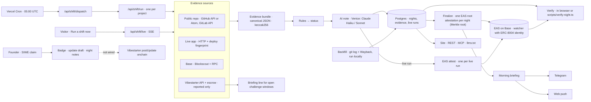

# Lights On

**Know by morning whether the teams you backed are still shipping.** Every night an agent checks each watched project's public repo, live app and onchain activity, decides a status with published rules, and attests the result on Base.

**<!-- num:field.hackathon.quiet30 -->30<!-- /num --> of <!-- num:field.hackathon.withHistory -->33<!-- /num --> hackathon builds on Base that we watch showed no detected commit or deploy activity in the last 30 nights.**

Basis: <!-- num:headline.basis -->reconstructed history (git + Wayback), not attested<!-- /num -->, nights <!-- num:headline.window30From -->2026-10-08<!-- /num --> to <!-- num:headline.latestNight -->2026-11-06<!-- /num -->. Only projects with a usable 30-night window are counted. For comparison, <!-- num:field.reference.active30 -->8<!-- /num --> of <!-- num:field.reference.withHistory -->8<!-- /num --> large reference apps (Uniswap Interface, Aave Interface, Safe{Wallet} and others) showed activity in the same window. "No detected activity" means nothing seen in public repos, the live app or listed contracts. It does not mean a team has stopped; see [Honest limits](#honest-limits) and [CLAIMS.md](CLAIMS.md).

Live: **https://lights-on-watch.vercel.app** · Review path: [JUDGES.md](JUDGES.md) · Onchain proof: [PROOF.md](PROOF.md)

## The morning question

You put money into a small onchain project a few months ago. It's morning, the team's channel has been quiet for weeks, and you can't tell whether they are heads-down shipping or gone.

## What it does

**The night shift.** At 05:00 UTC a watcher checks every project on the watch list:

1. **Evidence.** It reads the public repo (commits, releases and tags on GitHub or GitLab), the live app (does it answer, did its deploy fingerprint change) and Base (contract creations by the project's listed deployers). A source either answers or is marked failed; nothing is guessed. Everything it saw goes into one evidence bundle, hashed (keccak256 of canonical JSON) and published at `/api/v1/evidence/<hash>`.
2. **Status, by rules.** Fixed rules turn the bundle into one of five statuses: shipped, building, quiet, down, unavailable. The same bundle always gives the same status.
3. **AI explanation.** After the status is decided, a model writes a one-to-two-sentence note for holders. It cannot change the status. If it fails, the night says "explanation unavailable".
4. **Attestation on Base.** One EAS transaction per night: a Merkle root of every project's verdict. Each project-night (its status, its count of lit nights in the last 30 and the evidence hash) is one leaf, and the watcher, which holds an ERC-8004 identity, attests the root once. Every night carries its own proof into that root.
5. **Morning briefing.** Subscribers get a short summary of their projects by Telegram or web push.

**Run a shift now.** Every project page can run the same pipeline on demand and stream each step, ending on its own Base attestation.

**For backers.** Paste a wallet address or ENS name. Lights On finds the watched projects it backed on Vibestarter or holds as a token, and shows how each did last night. No login, no wallet connection.

**Vibestarter raises.** The project page of a Vibestarter raise shows the tranche schedule read from Vibestarter. When a founder has requested a tranche, it adds a countdown to the end of the backers' challenge window, next to the project's 30-night delivery record. Vibestarter data is shown as reported and never counts toward a status. Challenges are filed on Vibestarter itself.

**For founders.** A founder claims a project by signing in with Ethereum. The claim is proven either by signing from the Vibestarter founder wallet or by publishing a nonce at `<live app>/.well-known/lights-on.txt`. A claim gives a status badge, a backer-update draft built from the last 30 nights of evidence, and a right of reply: a note on any night, shown as reported next to what was verified. A claim never changes a status.

**Watch anything.** `/add` takes a live URL (plus a repo or contract if you have them) and runs the first check right away. Community-added projects stay unlisted until reviewed.

**Open surfaces.** REST with an OpenAPI spec, an MCP server for agents, `llms.txt`, and an ERC-8004 registration file.

## Try it in 2 minutes

No wallet, no account.

1. Open **https://lights-on-watch.vercel.app**. Each window in the building is a watched project, lit by last night's status.
2. Click a window, or open [/p/revoke-cash](https://lights-on-watch.vercel.app/p/revoke-cash). You get the status, the streak, lit nights in the last 30 and a 90-night strip. Hatched nights are reconstructed; solid ones were observed by the watcher.
3. Press **Run a shift now**. The agent reads the repo, the live app and the chain, applies the rules, writes the note, seals the evidence and attests on Base. The result links to easscan.
4. Click an observed night in the strip, then **Verify in this browser**. Your browser re-hashes the published evidence, reads the night's root attestation from Base, checks schema, attester and night, and checks that this night's Merkle proof leads from its leaf to the attested root.
5. Click **Check your bags** in the top bar, then **Try a real backer** ([/b/0x60bc…e345](https://lights-on-watch.vercel.app/b/0x60bc5323c0e0e9144af0b35ce8de119fc743e345)). That is a public wallet that backed Corvo Edge on Vibestarter, shown with its morning briefing.

## How it works

One Next.js app on Vercel, Postgres on Neon, EAS on Base mainnet. Solid arrows are live paths; dotted arrows are not wired.



- Adapters never throw: a failing source is recorded as failed and the night is decided from the rest.
- Reconstructed nights (from the backfill) are stored and shown, but never attested. Once the watcher observes a night, its reading replaces the reconstructed one.
- The watcher only attests when it has a registered ERC-8004 identity; it never attests with agent id 0.
- Daily caps on gas, LLM tokens and live runs are Postgres counters and fail closed. Over the gas cap a run still finishes and reports `attestation: skipped`; over the LLM cap the note is left out. Neither ever shows a value that does not exist.

## The rules

Quoted verbatim from `RULES_TEXT` in [`src/lib/shift/rules.ts`](src/lib/shift/rules.ts), the same strings shown on [/methodology](https://lights-on-watch.vercel.app/methodology) (rules version `r1`):

- Each night covers the 24 hours ending at the shift time, and only verified evidence (what we observed ourselves) decides the status.
- Shipped: the live app has a new deployment (liveapp.new_deploy), or the repo published a release or tag in the window (repo.release), or a listed deployer created a contract (chain.new_deployment).
- Building: not shipped, and at least one commit by a non-bot author touched code rather than only docs, styling or config (repo.code_commits).
- Down: the live app failed twice in a row (a non-2xx/3xx response or a timeout) and nothing else shipped that night (liveapp.down).
- Quiet: none of the above - the app is not known to be down and no verified change was seen (none).
- Unavailable: none of the repo, live app or chain answered, or none of them applies to the project, so we make no claim either way (all.unavailable).
- Precedence is shipped, then building, then down, then quiet; unavailable applies only when none of repo, live app or chain answered.
- A site that answers 401, 403 or 429 is blocking our check, not down; we note it as liveapp.blocked and it never counts as down.
- A source that fails while others succeed is noted as source.<name>.failed and the status is decided from the rest.
- Vibestarter records never count toward any status; founder updates, Vibestarter activity feeds and contract usage counts are reported or informational and never make a night shipped or building.
- Streak is the run of consecutive shipped or building nights ending at the latest night; unavailable or missing nights neither extend nor break it, while quiet and down nights end it.
- Lit30 is the number of shipped or building nights among the 30 calendar nights ending today, and last ship is the latest night with status shipped.
- An AI model may explain a night afterwards but can never change its status.

**Why not count commits?** Commit graphs and shipping disagree in both directions. Over the same 30 nights, <!-- num:commitVsShip.commitsNoVerifiedShip -->5<!-- /num --> of <!-- num:commitVsShip.withHistory -->46<!-- /num --> projects with a usable window had commits but no detected deploy, and <!-- num:commitVsShip.shipNightsWithoutCodeCommits -->5<!-- /num --> projects had nights where a deploy, release or contract reached users with no code commit that night. Same basis as the headline.

## Proof and verification

| What | Value |
|---|---|
| Network | Base mainnet (chain id 8453) |
| EAS | `0x4200000000000000000000000000000000000021` |
| Schema registry | `0x4200000000000000000000000000000000000020` |
| Nightly root schema UID | `0xfe6c6dba61a36a6fbdf682e0d8bf3903a289ebb186e172c59aa9c578b673e726` (non-revocable, no resolver) |
| Nightly root schema | `bytes32 root,uint32 night,uint16 count,uint256 agentId,string manifestURI` |
| Live-run schema UID | `0x18fe45e82c5c9b1a176794774f023536a12794a76ee877ebfb0d713166e65d8b` (non-revocable, no resolver) |
| Live-run schema | `bytes32 projectKey,uint32 night,uint8 kind,uint8 status,uint16 lit30,bytes32 evidenceHash,uint256 agentId,string evidenceURI` |
| Attester (watcher) | `0x82e382eA991C5f48bFC565b8CfbcB6d91faD53D6` |
| ERC-8004 identity registry | `0x8004A169FB4a3325136EB29fA0ceB6D2e539a432` |
| Watcher agent id | `{{TBD:agent-id}}` · registration file: [/.well-known/agent-registration.json](https://lights-on-watch.vercel.app/.well-known/agent-registration.json) |

**One transaction per night: a Merkle root of every project's verdict.** Each observed project-night is a leaf, `keccak256(abi.encode(projectKey, night, 0, status, lit30, evidenceHash))`. The leaves are sorted and hashed pairwise (each pair in ascending order) up to one `root`, which the nightly shift attests once; `count` says how many project-nights it covers, and `manifestURI` points at the night manifest, a canonical JSON list of every leaf whose keccak256 is the hash in the URI (unlisted projects appear by `projectKey`, without a slug). Every project-night of the night shares that attestation UID and carries its own proof, the sibling hashes from its leaf to the root. Up to 500 projects fit in one transaction, and its gas does not depend on how many leaves the root covers. A live run is attested on its own under the live-run schema.

Field meanings: `projectKey` = keccak256 of the project slug · `night` = UTC date as yyyymmdd · `kind` 0 = nightly, 1 = live run · `status` 1 shipped, 2 building, 3 quiet, 4 down, 5 unavailable · `lit30` = lit nights among the last 30 · `evidenceHash` = keccak256 of the bundle's canonical JSON · `evidenceURI` = where that bundle is served. Transactions and attestation UIDs are listed in [PROOF.md](PROOF.md).

**Verify in the browser.** Open a project, click an observed night, press **Verify in this browser**. It checks that the bundle re-hashes to its published hash, the attestation exists on Base, uses the nightly root schema, was made by the watcher's address, is neither revoked nor expired, and is for this night. Then it rebuilds the night's leaf from the bundle and the night's status and lit30 and checks that the proof leads to the attested root: a wrong status, a wrong lit30 or one changed byte of evidence and it no longer does. The drawer shows the proof (`Merkle proof · N steps → root 0x…`) and links the night manifest.

**Verify from a terminal**, with the repo checked out:

```bash
SITE=https://lights-on-watch.vercel.app
curl -s "$SITE/api/v1/evidence/<evidenceHash>" -o evidence.json
cast keccak "$(cat evidence.json)"        # prints <evidenceHash>: the body is exactly what was hashed
pnpm tsx scripts/verify-night.ts --network base \
  --uid <attestationUid> --bundle evidence.json --site "$SITE" \
  --attester 0x82e382eA991C5f48bFC565b8CfbcB6d91faD53D6
```

`verify-night.ts` is read-only. For a nightly night it reads the night's status, lit30 and Merkle proof from `--site` and checks them against the root on Base, so a wrong value from the site fails instead of passing. It prints PASS or FAIL per check and exits 0 only on a full match (2 on a mismatch, 1 on an error). `evidenceHash`, `attestationUid` and the proof fields for any night come from `GET /api/v1/projects/<slug>/nights`. To reproduce the status itself, run `decideStatus` from `src/lib/shift/rules.ts` over the same bundle.

## API and MCP

Read endpoints need no key, answer JSON and send open CORS. Responses are cached for 5 minutes; evidence bundles and night manifests, being content-addressed, are cached indefinitely. Full spec: [/api/openapi.json](https://lights-on-watch.vercel.app/api/openapi.json). Agent summary: [/llms.txt](https://lights-on-watch.vercel.app/llms.txt).

| Method | Path | Returns |
|---|---|---|
| GET | `/api/v1/projects?with=lastNight,history` | Listed projects with latest status and 30-night record; `history` adds 90 daily statuses |
| GET | `/api/v1/projects/{slug}` | One project: sources, status, record, latest night with reasons and attestation |
| GET | `/api/v1/projects/{slug}/nights?from=yyyymmdd&to=yyyymmdd` | Nights, observed and reconstructed, each with evidence hash and attestation; observed nights add their Merkle proof (`attestProof`, `attestLeaf`, `attestRoot`, `attestLit30`, `manifestHash`) |
| GET | `/api/v1/evidence/{hash}` | The canonical evidence bundle; keccak256 of the body equals `hash` |
| GET | `/api/v1/manifest/{hash}` | The night manifest behind a root attestation: every leaf; keccak256 of the body equals `hash` |
| GET | `/api/v1/briefing/{address}` | Backer briefing for a 0x address or ENS name |
| POST | `/api/v1/watch` | Watch a new project `{ liveUrl, repo?, contract? }`; rate-limited |
| GET | `/api/shift/live?project={slug}` | A live run as server-sent events (`step` events, then `done`); rate-limited |
| GET | `/badge/{slug}` | SVG status badge |
| GET | `/.well-known/agent-registration.json` | ERC-8004 registration file |
| GET, POST | `/api/mcp` | MCP server, Streamable HTTP |

```bash
curl -s https://lights-on-watch.vercel.app/api/v1/projects/revoke-cash
```

**MCP tools:** `list_projects`, `get_project`, `get_night`, `is_still_shipping`, `get_briefing`, `watch_project`. All are read-only except `watch_project`. Start with `is_still_shipping { "slug": "revoke-cash" }`.

Claude Code:

```bash
claude mcp add --transport http lights-on https://lights-on-watch.vercel.app/api/mcp
```

Cursor, in `.cursor/mcp.json`:

```json
{
  "mcpServers": {
    "lights-on": { "url": "https://lights-on-watch.vercel.app/api/mcp" }
  }
}
```

MCP Inspector, or plain curl:

```bash
npx @modelcontextprotocol/inspector --cli https://lights-on-watch.vercel.app/api/mcp \
  --transport http --method tools/call --tool-name is_still_shipping --tool-arg slug=revoke-cash

curl -s https://lights-on-watch.vercel.app/api/mcp \
  -H 'content-type: application/json' -H 'accept: application/json, text/event-stream' \
  -H 'mcp-protocol-version: 2025-06-18' \
  -d '{"jsonrpc":"2.0","id":1,"method":"tools/call","params":{"name":"is_still_shipping","arguments":{"slug":"revoke-cash"}}}'
```

Limits: live runs 3 per visitor per 10 minutes and 10 per visitor per day, 1 per project per 5 minutes, 100 per day overall; watches 3 per caller per day, 50 per day overall; briefings 30 per caller per 10 minutes.

## Run locally

Requires Node.js, pnpm and a Postgres database (a free Neon branch works).

```bash
git clone {{TBD:repo-url}} lights-on && cd lights-on
pnpm install
cp .env.example .env.local          # set DATABASE_URL and NEXT_PUBLIC_SITE_URL at minimum
pnpm exec drizzle-kit migrate       # creates the tables
pnpm dev                            # http://localhost:3000
```

Run a nightly shift by hand: `curl -H "Authorization: Bearer $CRON_SECRET" http://localhost:3000/api/shift/dispatch`.

Environment, from [`.env.example`](.env.example):

| Variable | Used for | Required |
|---|---|---|
| `DATABASE_URL` | Postgres connection | Required |
| `NEXT_PUBLIC_SITE_URL` | Public origin; written into every attestation's `evidenceURI` | Required |
| `INTERNAL_RUN_TOKEN` | Signs internal shift calls and salts requester hashes; live runs, `/add` and `watch_project` answer 503 without it | Required for shifts |
| `CRON_SECRET` | Authorizes the cron routes (`/api/shift/dispatch`, `/api/shift/finalize-stale`) | Required for the nightly shift |
| `VENICE_API_KEY` | AI notes, briefing wording, update drafts; without it nights say "explanation unavailable" | Optional |
| `WATCHER_PRIVATE_KEY` | Signs attestations; without it attestation reports `skipped (disabled)` | Optional |
| `GITHUB_READ_TOKEN` | Fine-grained read-only token; without it GitHub is read from Atom feeds (no file lists) | Optional |
| `TELEGRAM_BOT_TOKEN`, `TELEGRAM_WEBHOOK_SECRET` | Telegram briefings (set the webhook with `pnpm tsx scripts/telegram-set-webhook.ts`) | Optional |
| `VAPID_PRIVATE_KEY`, `NEXT_PUBLIC_VAPID_PUBLIC_KEY` | Web push (generate with `pnpm exec web-push generate-vapid-keys`) | Optional |
| `NEXT_PUBLIC_CHAIN_ID` | Chain id, default 8453 | Optional |
| `NEXT_PUBLIC_WATCHER_ADDRESS` | Attester allowlist for in-browser Verify and the default for `verify-night.ts` | Optional |
| `NEXT_PUBLIC_BASE_RPC_URL` | RPC the browser reads attestations from | Optional |
| `NEXT_PUBLIC_TELEGRAM_BOT` | Bot username; the Telegram subscribe link is hidden when unset | Optional |

Also read by the code:

| Variable | Used for | Required |
|---|---|---|
| `WATCHER_AGENT_ID` | ERC-8004 agent id of the watcher; nothing is attested without it | Optional (needed to attest) |
| `BASE_RPC_URL` | Server-side Base RPC (default: a public node) | Optional |
| `ETH_RPC_URL` | ENS resolution on the backer page | Optional |
| `INTERNAL_BASE_URL` | Origin the dispatcher calls for per-project runs | Optional |
| `DATABASE_URL_UNPOOLED` | Direct connection for migrations | Optional |

Onchain setup, once per network (needs a funded `WATCHER_PRIVATE_KEY`):

```bash
pnpm tsx scripts/register-schema.ts --network base          # both schemas; --which root|single for one
pnpm tsx scripts/register-agent.ts --network base --uri https://<site>/.well-known/agent-registration.json
```

Both accept `--network fork` to run against a local anvil fork of Base first.

**Tests.**

```bash
pnpm vitest run          # unit and integration tests; Postgres runs in-memory (pglite), no network
pnpm test:fork           # attestation round trip on a local anvil fork of Base (needs Foundry; skipped without anvil)
pnpm exec playwright test                                            # page smoke tests against next dev
BASE_URL=https://lights-on-watch.vercel.app pnpm exec playwright test  # the same, against the live site
```

**Numbers.** Every number in this README sits in a `<!-- num:… -->` span filled from `results/*.json`. To recompute them from a populated database and re-render:

```bash
pnpm tsx scripts/study.ts && pnpm tsx scripts/render-readme.ts README.md
```

`render-readme.ts` fails on any unknown key, and refuses to render a survivor-biased median on its own.

## Honest limits

- **Private repos are invisible.** A team that ships from a private repo shows only its deploys and contracts, so it can read quiet while busy.
- **Projects without a repo have sparse history.** Their reconstructed nights come from Wayback captures, which exist for some sites rarely or never. Most of that history is unknown, not quiet.
- **Contract creations come from Blockscout.** When Blockscout does not answer, new deployments can be missed that night and the chain source is marked failed.
- **Base holds the root, not each verdict.** One attestation per night carries the Merkle root. The leaves, each night's proof and the night manifest are served by the site and checked against that root; a saved manifest stays checkable without the site, but a single verdict cannot be read from the chain alone.
- **Reconstructed is not observed.** The 90 nights before the watch started were rebuilt from git history and Wayback captures. They are labelled, hatched, and never attested. The study numbers above use them.
- **A deploy is not a feature.** A changed deploy fingerprint means new code reached users, not that it mattered. On a static page without hashed assets, a change of visible text counts as a deploy. The evidence shows what changed.
- **The AI explains; it never decides.** The note is written after the rules decide. If the model fails or runs out of budget, the status is unchanged and the note is missing.
- **Social signals are not read.** Posts on X, Discord or Farcaster never count. Only work that reached users does.
- **Some rate limits are per instance.** The briefing limit and the validation-attempt guard on watches live in memory on each serverless instance. The durable caps (live runs, watches per day, gas, LLM tokens) are in Postgres.
- **Vibestarter is reported, not verified.** The tranche schedule is read from Vibestarter's API. Posting founder updates onchain is not wired yet; open challenge windows are recorded nightly and appear in briefings.

## License

[MIT](LICENSE)
